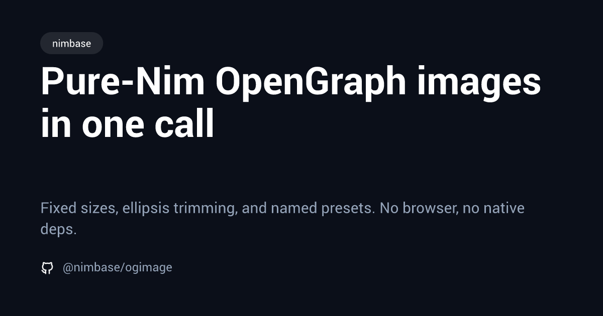
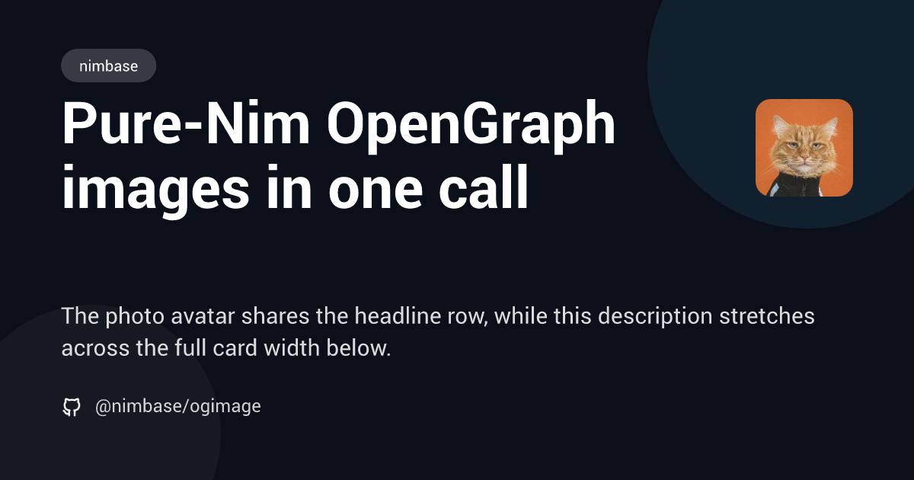
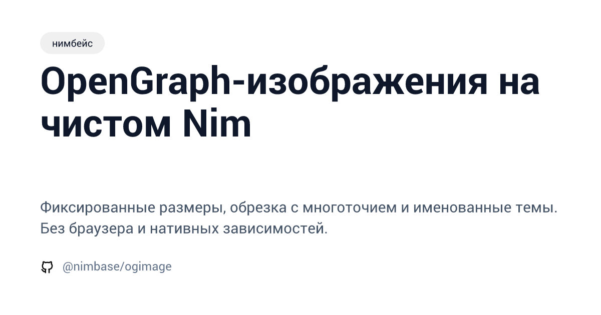
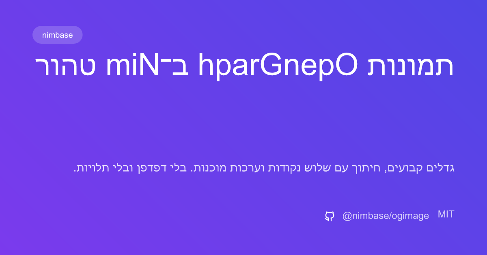

<p align="center">
  Pure-Nim OpenGraph image generator (1200x630 PNG cards, zero native deps)<br>
</p>

<p align="center">
  <code>nimble install ogimage</code>
</p>

<p align="center">
  <a href="https://nimbase.github.io/ogimage/">API reference</a><br>
    
</p>


## Features
- Nim objects in, PNG out: build an `OgImage` value, call `savePng` or `encodePng`
- Six named presets: dark, light, gradient, photo, minimal, brand
- Fixed type sizes with ellipsis trimming (long copy ends in `...`, never overflows)
- Photo avatar in the headline row (128x128, 20px rounded mask, cover-fit)
- Repo footer with GitHub mark + handle, auto light/dark variant
- Labeled gray placeholders (`128x128`, ...) wherever an image fails to load
- Retina output via `scale = 2.0` (2400x1260, same layout, same code)
- Cyrillic, RTL Hebrew (with right alignment), and fallback fonts
- Pure Nim on top of `nvg`: PNG encode included, no browser, no C libs

## Examples
```nim
import ogimage

var og = newOgImage("Pure-Nim OpenGraph images in one call",
  "Fixed sizes, ellipsis trimming, and named presets.",
  opDark)
og.content.badge = "nimbase"
og.content.repo = "@nimbase/ogimage"
og.repoIconDark = "tests/data/github-white.png"
og.repoIconLight = "tests/data/github-black.png"
og.fontTitlePath = "tests/data/Roboto-Bold.ttf"
og.fontBodyPath = "tests/data/Roboto-Regular.ttf"
og.savePng("og_dark.png")

# Retina, photo avatar, RTL Hebrew (needs a Hebrew-covering font):
var og2 = newOgImage("תמונות OpenGraph ב־Nim טהור",
  "גדלים קבועים, חיתוך עם שלוש נקודות וערכות מוכנות.",
  opGradient)
og2.hasAlign = true
og2.align = thaRight
og2.fontTitlePath = "/System/Library/Fonts/Supplemental/Arial Unicode.ttf"
og2.fontBodyPath = "/System/Library/Fonts/Supplemental/Arial Unicode.ttf"
og2.scale = 2.0
og2.savePng("og_hebrew.png")
```

| dark | photo |
| ---- | ----- |
|  |  |

| russian | hebrew |
| ------- | ------ |
|  |  |

More cards (light, gradient, minimal, brand, long-copy ellipsis, missing-asset
placeholders, retina) are rendered by `examples/demo.nim` into `examples/out/`.

### ❤ Contributions & Support
- 🐛 Found a bug? [Create a new Issue](https://github.com/nimbase/ogimage/issues)
- 👋 Wanna help? [Fork it!](https://github.com/nimbase/ogimage/fork)

### 🎩 License
MIT license | Nim Community.
